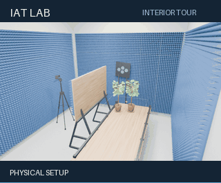

# IAT Lab

Editable Blender model of the IAT laboratory, with parametric scene controls
and Sionna RT export tools.

The lab layouts draw on supplied photographs, the room plan and
[Radpour et al.'s RIS experiment](https://arxiv.org/abs/2402.04844v2), including
its transmitter, RIS, blocker and receiver-scanner arrangement. See the
[layout references](docs/LAB_REFERENCES.md#published-experimental-layout-reference)
for the relationship to this project's four-RIS and plant configurations.

Open **[`scenes/IAT_Lab.blend`](scenes/IAT_Lab.blend)** in **Blender 5.2.3 LTS**.
It now has **19 Geometry Nodes assembly controllers**, wall-mounted absorber
controls, a radio-material catalog with sources and qualification status, and an
exporter for **Sionna RT 2.2**. The default layout preserves the supplied model.
All four scene variants, cameras and archived results are retained; the original
file is protected under `assets/baseline/`.



Six-second interior tour with all walls visible, followed by archived paths and
heatmap overlays. [Animation and reproduction steps](docs/ANIMATION.md) ·
[High-resolution Cycles previews](docs/PREVIEWS.md).

To edit the environment, expand **`00 IAT Controls`**, select a **`CTRL | …`**
object and adjust its **`IAT - component controls`** modifier. Position and size
are in metres. Each wall has its own absorber toggle and dimensions.
Each scene's results collection contains separate **Paths** and **Heatmap**
subcollections for independent visibility.

| Scene | Setup |
| --- | --- |
| 01 Plants - active RIS | Close-pair plants with active RIS |
| 02 Plants - reflective RIS | Close-pair plants with reflective RIS |
| 03 No plants - active RIS | Matched computational baseline |
| 04 No plants - reflective RIS | Matched computational baseline |

## Understand the model

- [Original lab references](assets/references/README.md): two photographs,
  dimensioned room plan and model-derived schematic, with source notes and hashes.
- [Lab reference audit](docs/LAB_REFERENCES.md): what the supplied archive supports
  and which dimensions/material assumptions remain unresolved.
- [Parametric environment](docs/PARAMETRIC_ENVIRONMENT.md): all 19 controllers,
  position/size/rotation, attached absorbers, member controls and reset/rebuild steps.
- [Radio-material supplement](docs/RADIO_MATERIALS.md): dielectric properties,
  assignments, sources, frequency models and qualification status.
- [Sionna RT export](docs/SIONNA_EXPORT.md): deterministic evaluated meshes,
  explicit radio materials and a pinned runtime checker.
- [Baseline scene organization and visibility](docs/SCENE_GUIDE.md): the 12 original collections,
  scene membership, shared objects, cameras and the exact cutaway visibility rules.
- [Archived path Geometry Nodes](docs/GEOMETRY_NODES.md): the two inherited path groups, flow diagrams,
  every exposed control, saved scene settings and practical filtering recipes.
- [Baseline inspection record](docs/scene_reference.json): machine-readable collection
  contents, visibility flags, socket interfaces and saved modifier values.

## Repository layout

```text
iat_lab/                       reusable Python API and command-line interface
  project.py                   manifest, paths and baseline verification
  blender/                     scene inventory, text export and Sionna RF export
  nodes/                       environment graph builders and node asset extraction
  materials.py                 material models and catalog validation
config/                        editable RF catalog and recorded assembly defaults
assets/baseline/               original .blend, protected by SHA-256
assets/references/             selected lab photos, room plan and model schematic
scenes/IAT_Lab.blend            editable working model
data/baseline_inventory.json   reviewable scene and node metadata
data/embedded/                 text and numerical records extracted from the model
scripts/                      thin Blender entry points
examples/                     Python API example
tests/                        Python checks and Blender integration smoke test
docs/                         scene/node guides, architecture, workflows and provenance
.github/workflows/             automated Python and input-integrity checks
build/, runs/, renders/        local generated outputs, ignored by Git
```

## Inspect and validate

Python 3.11+ is sufficient for the project API and integrity checks; there are
no runtime dependencies outside Blender. Run these commands from the repository:

```powershell
python -m iat_lab info
python -m iat_lab verify
python -m unittest discover -s tests -v
```

Optional install into your own virtual environment: `python -m pip install -e .`.
The installed command is `iat-lab`. Code is packaged; scene assets stay in the
checkout. Outside the checkout, use `iat-lab --project C:\path\to\iat-lab info`.

## Blender tools

On Windows, point `$blender` to your Blender executable:

```powershell
$blender = 'C:\Program Files\Blender Foundation\Blender 5.2\blender.exe'
& $blender --background --factory-startup --disable-autoexec scenes/IAT_Lab.blend --python-exit-code 1 --python scripts/inspect_scene.py -- --output runs/current_inventory.json
& $blender --background --factory-startup --disable-autoexec scenes/IAT_Lab.blend --python-exit-code 1 --python scripts/build_node_library.py -- --output build/nodes.blend
& $blender --background --factory-startup --disable-autoexec --python-exit-code 1 --python tests/blender_smoke.py
```

These commands inspect the scene or extract reusable node assets without saving
over the working model. In Blender, use **File > Append** and choose the
**NodeTree** folder of `build/nodes.blend` to reuse the groups in another file.

For the first modelling change, edit `scenes/IAT_Lab.blend`, save it, capture a
new inventory under `runs/`, and commit the model with a description of the change.
See [Blender workflow](docs/BLENDER.md) and [contributing](CONTRIBUTING.md).

## Architecture and scope

The project separates the Python API, Blender integration, node assets,
tests and documentation so scene editing and simulation exports remain reproducible.

The environment graphs are built from versioned Python definitions over the
protected detailed meshes. No add-on or auto-run Python is needed to use the
saved controls. Geometry edits do not recompute the archived paths or heatmaps.
The exporter writes RIS cell geometry/state metadata but does not implement
active RIS scattering. RF-absorber properties remain an explicitly labeled
proxy until the product is characterized. See [architecture](docs/ARCHITECTURE.md),
[provenance](docs/PROVENANCE.md) and [rights](docs/RIGHTS.md).
