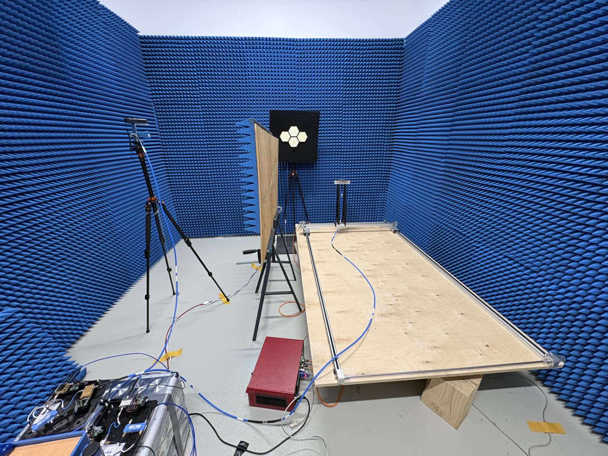
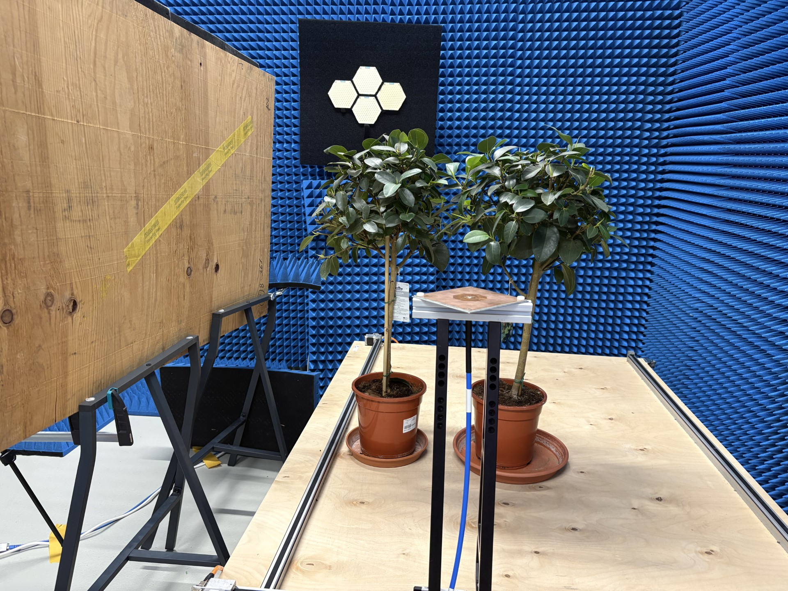
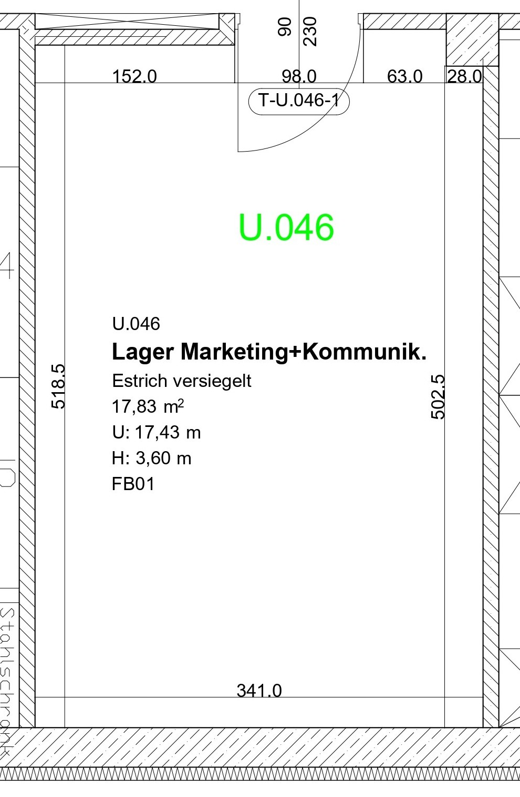
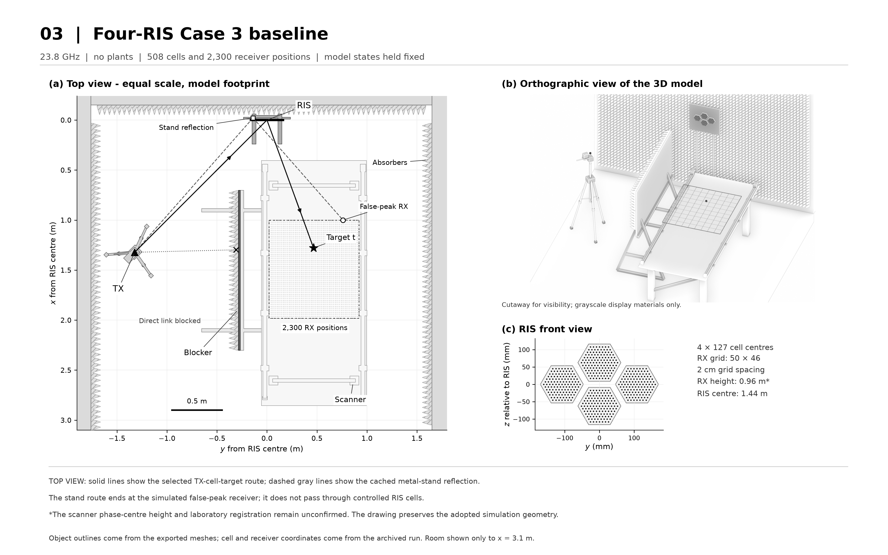

# Laboratory photographs, plan and model schematic

Four references selected by the repository owner from the supplied `01_RIS`
archive for public inclusion on 10 November 2026. The image bytes are unchanged.
The [manifest](manifest.json) records original relative paths, SHA-256 hashes
and interpretation notes. Original authorship/licensing information was not
established by this audit; inclusion does not assign a new license to the images.

## Laboratory overview photograph

Source: `RIS_Journal_Revised_2026-10-07/deferred/original_figures/Lab_space.jpg`.
Useful for absorber coverage, visible finishes, transmitter, blocker and scanning
table. The photograph is an arrangement/appearance reference, not a survey.

## Plant-layout photograph

Source: `RIS_Case3_Photo_Shield_Tilt_2026-10-14/inputs/photo_high_resolution_plant_layout.jpg`.
Shows the plant pair, pots, scanner hardware, wooden blocker and dark RIS
backing. Exact antenna phase-center registration and common height datum remain
unconfirmed. The current model retains its documented support-height hypothesis.

## Dimensioned U.046 room plan

Source: `RIS_Journal_Revised_2026-10-07/deferred/original_figures/FB UG Raum U.046_page-0001l.jpg`.
The plan labels 341.0 cm width, 518.5 cm and 502.5 cm side lengths, 3.60 m height,
17.83 m² area and a doorway/recess arrangement. The Blender model uses a
simplified 3.41 × 5.185 × 3.60 m rectangular envelope. The unequal side lengths
and recess are evidence for a later architectural-detail review, not silently
applied geometry changes.

## Model-derived four-RIS schematic

Source: `RIS_Model_Based_Schematics_2026-10-14/figures/03_Four_RIS_Case3.png`.
Read the original [provenance and captions](schematic-captions.txt), particularly
the geometry basis and caption 3. This figure comes from older saved triangle
meshes, cells, receiver coordinates and cached routes. It depicts a no-plant
Case 3 baseline, not the current parametric plant scene or a new Sionna RT 2.2
result. Its dashed route is an archived diagnostic reflection. It is a model
schematic, not a dimensioned survey or free-form generated illustration.

See the [reference audit](../../docs/LAB_REFERENCES.md) for related useful files,
geometry limitations and why absorber dielectric properties remain provisional.
