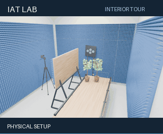

# Setup animation



A six-second camera loop inside the full room: **320 × 264 pixels**, including
captions, **48 frames at 8 fps**. All four walls, the ceiling and floor are
visible to the renderer. The camera follows a small, smooth arc through the
rear of the room, returning continuously to its starting view.

The first part shows the physical setup. From 2 to 5 seconds, the original
Paths and Heatmap objects become visible with the caption **ARCHIVED PATHS +
HEATMAP**. Those overlays are saved results, not newly computed propagation or
time-varying RF behavior. Apparatus geometry stays at the saved default values.

The GIF uses native Blender **Eevee** with the procedural materials and interior
area lighting. The higher-resolution [still previews](PREVIEWS.md) use Cycles.
No AI image generation, imported footage or external texture images are used.

## Reproduce

Run from the repository root with Blender 5.2.3 LTS and Python 3.11+:

```powershell
$blender = 'C:\Program Files\Blender Foundation\Blender 5.2\blender.exe'
python -m pip install -r requirements-animation.txt
& $blender --background --factory-startup --disable-autoexec scenes/IAT_Lab.blend --python-exit-code 1 --python scripts/render_animation.py
python scripts/package_animation.py
```

The first command renders PNG frames into `build/setup-animation/`. The packaging
script downsamples the 640 × 400 renders and uses Pillow to add captions and encode
a shared 128-color palette, keeping
colors consistent across frames. GIF delays alternate between 120 and 130 ms
to preserve exactly six seconds despite GIF's 10 ms timing resolution. The
animation loops indefinitely.

Rendering does not save over the working `.blend`. Only generated files in the
chosen output locations are replaced. The [animation record](images/setup-tour.json)
contains the source model hash, Blender/Pillow versions, camera positions,
visibility states, PNG hashes, final GIF hash and file size.

## Adjust the animation

Pass options after Blender's `--` separator:

- `--frames`, `--fps`, `--width`, `--height`: sequence length and dimensions.
- `--samples`: rendering samples; the default is 16.
- `--engine eevee` (default) or `--engine cycles`: rendering engine.
- `--output`: PNG sequence directory.
- `--start` and `--end`: preview a subset of frames; the end is exclusive.

The packaging script requires a complete sequence and accepts `--input`,
`--output` and `--width` (320 by default). Camera trajectory and overlay timing are defined in
[`scripts/render_animation.py`](../scripts/render_animation.py). The trajectory
fits the default room; revisit it after changing the room dimensions or layout.

For a higher-quality Cycles version, choose `--engine cycles --samples 64` and
allow additional rendering time. Different Blender builds, rendering hardware
and denoisers can produce slightly different pixels.
