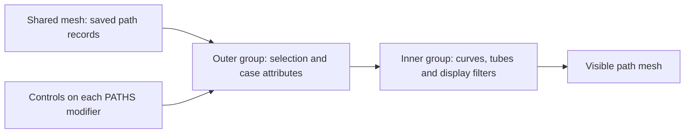
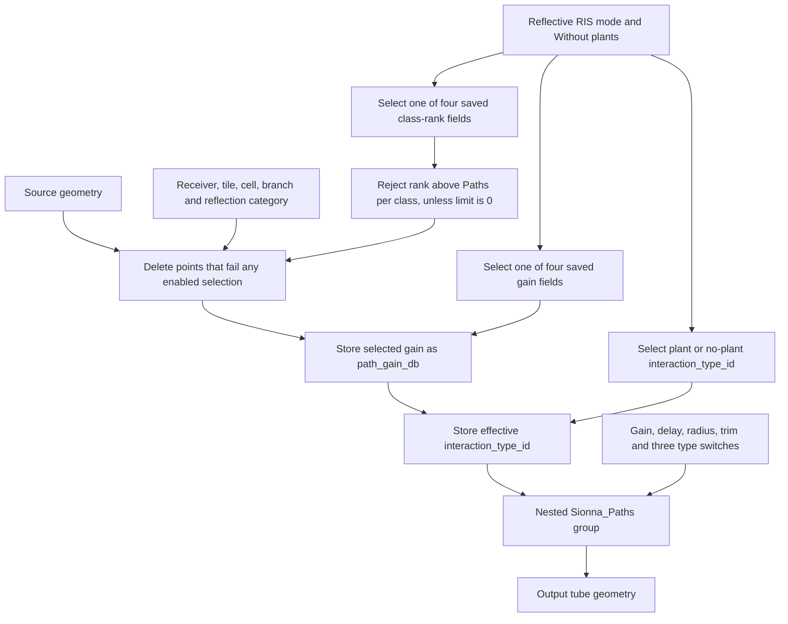
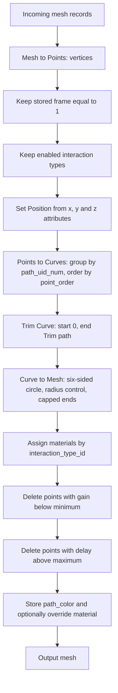

# Archived path Geometry Nodes and controls

The model retains two shared path-display Geometry Nodes groups. Together they turn saved
propagation-path records into visible tubes. They select and display existing
results; they do not generate plants or run a radio simulation.

The new environment groups are covered in [Parametric environment](PARAMETRIC_ENVIRONMENT.md).
This document describes the two inherited path graphs, whose wiring and saved
inputs are retained.

This guide describes the wiring and values read directly from
`scenes/IAT_Lab.blend` in Blender 5.2.3 LTS on 10 November 2026. For collection
membership, cutaway visibility and cameras, see the [scene guide](SCENE_GUIDE.md).
The [inspection record](scene_reference.json) contains the exact socket names,
identifiers, ranges and saved modifier values behind the tables below.

## 1. Where the controls live

Choose a scene, select its `PATHS` object in the results collection, and open
the modifier tab. The modifier is named **`PATH FILTERS - presentation controls`**.
Its outer group is `RIS path controls | existing Sionna filters + receiver and cell`.
In the Geometry Node Editor, enter its node named `Group` to inspect the inner
group, `Sionna_Paths | embedded straight paths`.

| Group | Saved size | Responsibility |
| --- | --- | --- |
| Outer: `RIS path controls \| existing Sionna filters + receiver and cell` | 57 nodes, 82 links | Select receiver, cell, branch, reflection category and saved rank; choose the case's gains and interaction types; pass presentation controls inward. |
| Inner: `Sionna_Paths \| embedded straight paths` | 75 nodes, 75 links | Select stored frame/type records, reconstruct ordered curves, make tube meshes, assign materials and apply gain/delay filters. |

Node counts include organizational frames and repeated Group Input nodes.
All four path objects share these groups and one source mesh, but have separate
modifier settings. Editing a group changes all four scenes' path displays.



## 2. Outer-group controls

The following are the **saved values on the four modifiers**, rather than just
the defaults advertised by the group's interface. Numeric bounds are interface
bounds. `Geometry` is the source mesh input; the output is the final tube geometry.

| Control | Saved value | Range / meaning |
| --- | --- | --- |
| `Receiver index (-1 = all)` | `2300` | `-1..2300`. `-1` disables this filter; `0..2299` selects a scanner sample; `2300` selects the confirmed target. |
| `Tile index (-1 = all)` | `-1` | `-1..3`. Four tile indices `0..3`; `-1` disables this filter. |
| `Cell index (-1 = all)` | `-1` | `-1..507`. Global cell index across all 508 cells, not an index local to a tile. `-1` disables this filter. |
| `Show RIS branch` | On | Keeps branch ID 1 when enabled. Disabling removes RIS-mediated records. |
| `Show TX bypass` | On | Keeps branch ID 2 when enabled. This means the direct TX-to-RX branch without the RIS; it can include reflected paths. |
| `Reflection class (0 all; 1 none; 2 room; 3 plant)` | `0` | `0..3`. `0` disables this filter; `1` selects no extra reflection; `2` room reflection; `3` plant reflection. Uses `reflection_category`, independently of the interaction-type switches below. |
| `Paths per class (0 = all saved)` | `12` | `0..20000`. Retains saved class rank at most this value. `0` disables the rank limit. Rankings are per receiver, branch and reflection class for the selected case. |
| `Reflective RIS mode` | Varies by scene | Off selects active-case gain/rank fields; On selects reflective-case fields. Does not switch the glyphs or heatmap. |
| `Without plants` | Varies by scene | Selects the no-plant gain, rank and interaction-type fields. Does not hide the plant collection or rerun propagation. |
| `Minimum path gain (dB)` | `-180` | `-300..0` dB. Removes records below the threshold; equality is retained. Gain is not received power in dBm. |
| `Maximum delay (ns)` | `100` | `0..1000` ns. Removes records above the threshold; equality is retained. |
| `Path radius (m)` | `0.001` | `0..0.02` m. Radius of a six-sided tube profile; the saved value is 1 mm radius, about 2 mm diameter. This is a display size. |
| `Trim path` | `1` | `0..1`. Fraction of each reconstructed curve to display, starting at its first ordered point. `1` shows its full length. |
| `No extra reflection` | On | Enables interaction type 0 through the inner `Paths LOS` input. Type 6 transmission-only records have a separate switch. |
| `Reflections` | On | Enables interaction type 2 through the inner `Paths Reflection` input. The reflection-class control can then select room or plant reflections. |
| `Transmission only` | On | Enables interaction type 6 through the inner `Paths Refraction` input. It does not control every path that may also transmit through vegetation. |

| Scene | Reflective RIS mode | Without plants | Gain / class-rank field prefix |
| --- | --- | --- | --- |
| 01 Plants - active RIS | Off | Off | `active_` |
| 02 Plants - reflective RIS | On | Off | `reflective_` |
| 03 No plants - active RIS | Off | On | `no_plant_active_` |
| 04 No plants - reflective RIS | On | On | `no_plant_reflective_` |

For example, scene 04 uses `no_plant_reflective_gain_db` and
`no_plant_reflective_class_rank`. In the group interface, both mode defaults
are Off; the modifier overrides are what make scenes 02, 03 and 04 different.
The other scalar and Boolean saved values above agree across the four scenes.

### How the filters combine

Selections are intersected. A record must survive **every enabled filter**.
Turning on a branch switch does not exempt its records from receiver, tile,
cell, rank, category, interaction-type, gain or delay filtering.

- Bypass records use tile and cell index `-1`. Selecting a particular tile or
  cell removes them even while `Show TX bypass` is On. Use `-1` for both to
  include bypass records.
- Selecting a tile and a cell from a different tile produces no matching RIS
  records. The graph does not automatically reconcile the controls.
- Class ranks are stored data, not recalculated after selecting a cell. If a
  cell's best path has saved rank 40, `Paths per class = 12` hides it. Use `0`
  when investigating an individual cell.
- `Reflection class = 1` selects no-reflection records, but the interaction-type
  switches still distinguish type 0 from type 6. Enable both `No extra reflection`
  and `Transmission only` to retain both kinds in that category.
- Enabling all receivers and removing the rank limit can produce a large mesh.
  Start with one receiver when exploring the archived records.

## 3. Inside the outer group



The first `Delete Geometry` node operates on the **point domain**. Seven
rejection predicates are joined with Boolean OR: receiver mismatch, tile
mismatch, cell mismatch, disabled RIS branch, disabled bypass branch,
reflection-category mismatch and excessive class rank.

Receiver/tile/cell comparisons are enabled only for nonnegative selectors.
Reflection category is stored as `0 = none`, `1 = room`, `2 = plant`; the graph
adds one before comparing it to the UI selection. UI value 0 bypasses that
comparison. A rank is rejected only when the limit is positive and the selected
saved rank is greater than the limit.

Two `Store Named Attribute` nodes then normalize the case for the inner group:

1. Write the selected case's gain to FLOAT/POINT `path_gain_db`.
2. Write either the original `interaction_type_id` or
   `no_plant_interaction_type_id` to INT/POINT `interaction_type_id`.

These writes affect the evaluated geometry. They do not rewrite the original
mesh or re-estimate gains. The inner group then receives that geometry and the
outer presentation controls.

## 4. Inside the inner group

The order below follows the actual geometry links, including the gain and delay
filters **after** conversion to a mesh.



### Reconstructing a path

`Sionna Embedded Mesh to Points` converts the input mesh vertices into points.
The graph discards records whose `frame` is not **1**. Although a `Scene Time.001`
node is present, it is disconnected: scrubbing the timeline does not select a
different stored frame in this version.

After interaction filtering, `Combine XYZ` reconstructs each point's position
from its stored scalar `x`, `y` and `z` attributes. `Points to Curves` uses
`path_uid_num` as Curve Group ID and `point_order` as Weight, preserving the
stored order of the vertices along each path. `Trim Curve` cuts the curve by
length fraction. `Curve Circle` supplies six profile vertices and `Curve to Mesh`
uses filled caps.

Changing only the source mesh vertices' ordinary positions will not update the
stored `x/y/z` coordinates used here. Moving the path object can move its display,
but neither operation recalculates the physical path solution.

Gain and delay rejection nodes operate on the generated mesh's point domain.
The supplied data stores path metadata on the source points and carries it
through the curve/mesh conversion. If replacing those records, preserve
consistent per-path metadata; these are point deletions, not a separate
whole-spline classification algorithm.

### Interaction gates and legacy material names

The gate keeps the union of enabled IDs. The graph's material names come from
an inherited setup and **do not consistently match its type-switch mapping**.
Use the actual wiring below when interpreting or editing the graph.

| Interaction ID | Inner gate | Outer control | Assigned material |
| ---: | --- | --- | --- |
| 0 | `Paths LOS` | `No extra reflection` | `path_LOS.001` |
| 1 | No gate; removed before materials | None | `path_reflection.001` assignment exists downstream but is unreachable for this ID in the current graph. |
| 2 | `Paths Reflection` | `Reflections` | `path_reflection.001` |
| 3 | No gate; removed before materials | None | `path_scattering.001` assignment exists downstream but is unreachable for this ID in the current graph. |
| 4 | `Paths Scattering` | Fixed Off inside outer group | `path_refraction.001` |
| 5 | `Paths Diffraction` | Fixed Off inside outer group | No explicit material assignment for this ID. |
| 6 | `Paths Refraction` | `Transmission only` | `path_diffraction.001` |

The saved plants-present attribute contains IDs **0, 2 and 6**; its no-plant
counterpart contains **0 and 2**. A type-6 path receiving a material named
`path_diffraction.001` is not evidence that diffraction was simulated. No
scattering or diffraction results are created by turning on the unused inner
switches.

### Every inner-group input

These are useful when appending the inner group independently or editing its
parent group. Its interface defaults are **not** the settings used by the
existing path modifiers.

| Inner input | Interface default; bounds | Binding inside the outer group |
| --- | --- | --- |
| `Geometry` | Geometry input | Filtered records with effective gain and interaction attributes. |
| `Path gain less than` | `-140`; `-300..0` dB | `Minimum path gain (dB)`, saved `-180`. Despite the legacy label, values below this threshold are deleted, so it is a lower bound. |
| `Delay less than (ns)` | `10000`; `0..10000` ns | `Maximum delay (ns)`, saved `100`; keeps delay less than or equal to the bound. |
| `Trim path` | `1`; `0..1` | `Trim path`, saved `1`. |
| `Path radius` | `0.1`; `0..100` m | `Path radius (m)`, saved `0.001`. |
| `Paths LOS` | Off | `No extra reflection`, saved On. |
| `Paths Reflection` | Off | `Reflections`, saved On. |
| `Paths Scattering` | Off | Fixed Off. |
| `Paths Diffraction` | Off | Fixed Off. |
| `Paths Refraction` | Off | `Transmission only`, saved On. |
| `Color Filter - Path single color` | Off | Fixed Off. When enabled, applies `Paths_single_color.001` to the output. |
| `Path color slider` | `1000`; `0..10000` | Fixed `1000`. Written to FLOAT/POINT `path_color` for the single-color material. It is a scalar material input, not an RGB picker. |

An independently appended inner group starts with every type gate Off. It also
expects the named attributes below; an ordinary mesh without them is not a
substitute for the saved records. The existing outer group supplies the correct
bindings, so its tubes are not built at the inner radius default of 0.1 m.

## 5. Attribute contract

The shared source mesh contains **776,009 vertices** describing **240,985 saved
paths**. These are input record counts, not counts of the evaluated tube mesh.
Scalar path attributes are on the POINT domain. The inspection record includes
their types, counts and measured ranges.

| Attribute(s) | Type | Use |
| --- | --- | --- |
| `receiver_index` | INT | Receiver selection; stored range `0..2300`. |
| `tile_index`, `cell_index` | INT | RIS selection; `-1` on bypass, otherwise tile `0..3` and global cell `0..507`. |
| `branch_id` | INT | `1` RIS branch; `2` TX bypass. |
| `reflection_category` | INT | `0` none; `1` room; `2` plant. |
| `active_class_rank`, `reflective_class_rank`, `no_plant_active_class_rank`, `no_plant_reflective_class_rank` | INT | Case-specific precomputed ranking; selected by the outer mode switches. |
| `active_gain_db`, `reflective_gain_db`, `no_plant_active_gain_db`, `no_plant_reflective_gain_db` | FLOAT | Four case-specific gains. The selected one becomes `path_gain_db`. |
| `interaction_type_id`, `no_plant_interaction_type_id` | INT | Plants-present and no-plant type IDs. The chosen field becomes effective `interaction_type_id`. |
| `path_gain_db` | FLOAT | Effective gain consumed by the inner filter, overwritten on evaluated geometry by the outer group. |
| `delay_ns` | FLOAT | Delay filter; source range approximately `8.316..33.038` ns. |
| `frame` | INT | All source records are frame 1; inner comparison is also fixed to 1. |
| `x`, `y`, `z` | FLOAT | Stored point coordinates used by Set Position. |
| `path_uid_num` | INT | Stable curve grouping, range `0..240984`. |
| `point_order` | FLOAT | Order along each curve, stored range `0..4`. |
| `path_color` | FLOAT | Written on evaluated tube geometry by the inner group. |

Other source attributes, including overall `active_rank` / `reflective_rank`
and background-object indices, are not read by these two graphs. In particular,
the outer limit uses the **class-rank** fields, not the overall rank fields.
The `.blend` remains authoritative; the general JSON inventory is not a
lossless serializer for rebuilding this data or its graphs.

## 6. Practical control recipes

Start by selecting the scene whose heatmap, plants and glyphs match the desired
case. Then select its path object and edit the modifier inputs.

| Goal | Settings |
| --- | --- |
| Return to the saved target view | Receiver `2300`; tile/cell `-1`; both branches On; reflection class `0`; paths per class `12`; gain `-180`; delay `100`; radius `0.001`; trim `1`; all three type switches On. Keep the scene's mode switches as listed above. |
| Examine one scanner sample | Receiver `0..2299`; tile/cell `-1`; initially keep rank limit `12`. |
| Inspect one RIS cell thoroughly | Receiver of interest; cell `0..507`; tile `-1`; RIS On; paths per class `0`; all three type switches On. Bypass will be excluded by the cell selection. |
| Show only the bypass branch | Tile/cell `-1`; RIS Off; TX bypass On; reflection class `0`. |
| Show only room reflections | Reflection class `2`; `Reflections` On. Choose receiver/branch independently. |
| Show only plant reflections | Use a plants-present scene; reflection class `3`; `Reflections` On. |
| Show only transmission-only records | Use a plants-present scene; `Transmission only` On; `No extra reflection` and `Reflections` Off; reflection class `0`. |
| Reveal a path progressively | Use a fixed receiver/cell selection and vary `Trim path` from near `0` to `1`. This trims geometry; it is not a time-of-flight animation. |

If nothing appears, check object and collection visibility first, then try one
receiver, tile/cell `-1`, reflection class `0`, paths per class `0`, all type
switches On, delay `100` and a sufficiently low gain threshold. Even with the
rank limit disabled, gain and delay filters still apply. Some stored case gains
are far below the allowed threshold range, so removing the rank limit does not
make every record visible.

## 7. Display versus computation

The embedded viewing notes describe the archived scanner display as the union
of the strongest 32 paths for each of four cases, plus the strongest four per
reflection class, with all bypass paths retained. At target receiver 2300, all
nonzero paths were saved. Thus `Paths per class = 0` means **all saved records
that pass the remaining filters**, not every path a solver could calculate.

The heatmaps use coherent sums of all calculated paths, independently of the
subset selected for the interactive tubes. They are raw simulated powers for
10 dBm TX, displayed on a fixed -90 to -20 dBm scale, without 10-wavelength
spatial averaging. Changing tube counts, colors or radius does not change them.

The archived calculation uses 23.8 GHz, fixed nominal RIS profiles, a finite
single-reflection-per-hop model and leaf/pot slab transmission. Metal reflections
were disabled while opaque blocking remained; nonmetal room reflections were
included. Diffuse scattering, diffraction, mutual coupling and amplifier noise
are outside that saved model. The lower 0.50 m support is an unconfirmed geometry
hypothesis. These are statements about the archived calculation, not new
validation of the physical setup.

For the original assumptions and numbers, read
[START HERE](../data/embedded/START%20HERE.txt),
[PROTOCOL](../data/embedded/PROTOCOL.json),
[Simulation manifest](../data/embedded/Simulation%20manifest.json), and
[Simulation maps](../data/embedded/Simulation_maps.csv).
Historical notes may mention solver outputs or images outside this checkout;
their mention does not mean those files are included in this repository.

## 8. Inspecting the saved controls

Blender 5.2 moved Geometry Nodes modifier inputs from ID properties to RNA
properties; see the official
[Blender 5.2 Python API release notes](https://developer.blender.org/docs/release_notes/5.2/python_api/).
The repository's original inventory captures group-interface defaults and node
connections, but its modifier custom-property fields do not capture those new
input values. Do not use an empty modifier custom-property dictionary to infer
that the scene uses interface defaults. Current schema-2 snapshots now include
actual values in `modifier_inputs` and eye states in `view_layers`.

This read-only snippet can be run in Blender's Python Console, using `exec` for
the multiline block, or from the Text Editor. It prints each Geometry Nodes modifier's actual
5.2 input values and their input modes without saving the file:

```python
import bpy

for obj in bpy.data.objects:
    for modifier in obj.modifiers:
        if modifier.type != "NODES" or modifier.node_group is None:
            continue
        print(obj.name, modifier.name)
        inputs = modifier.properties.inputs
        for socket in modifier.node_group.interface.items_tree:
            if socket.item_type != "SOCKET" or socket.in_out != "INPUT":
                continue
            prop = getattr(inputs, socket.identifier, None)
            if prop is not None:
                print(socket.name, getattr(prop, "type", None),
                      getattr(prop, "value", None))
```

For this baseline, the scalar/Boolean inputs use value mode. The geometry input
uses the incoming mesh fallback. To recheck hidden eye states, query
`obj.hide_get(view_layer=layer)` for every scene's view layer as well as the
global `hide_viewport` and `hide_render` flags. The documentation's
[inspection record](scene_reference.json) stores that additional evidence for
the exact source hash identified in the [scene guide](SCENE_GUIDE.md#6-evidence-and-scope).
