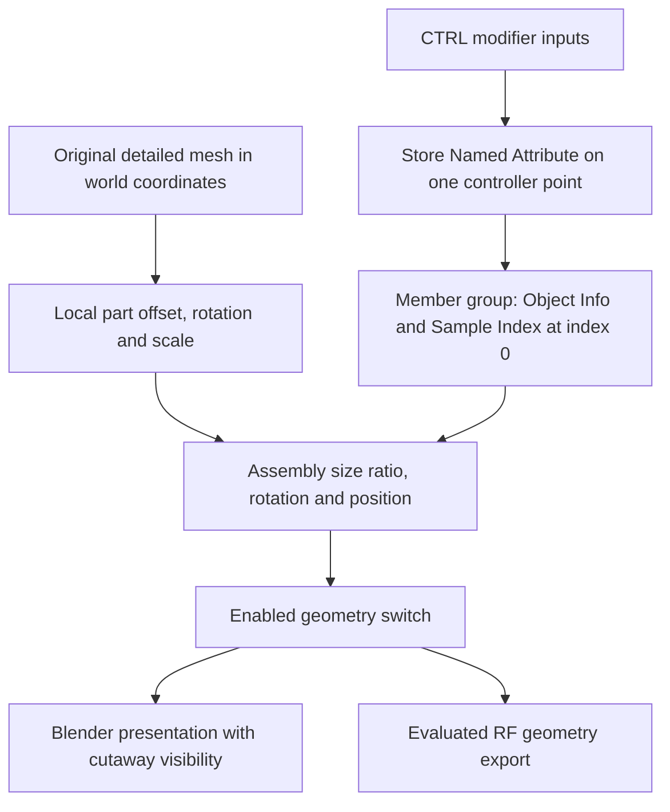
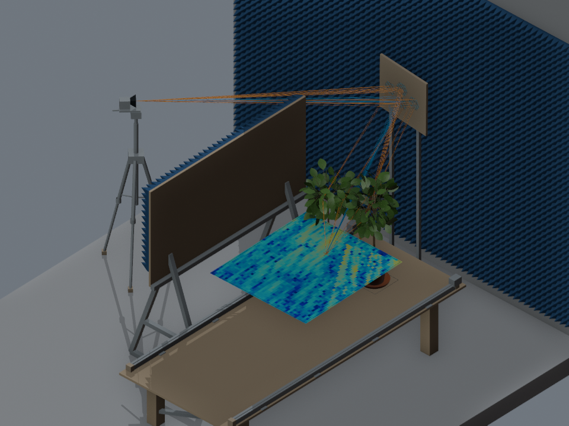
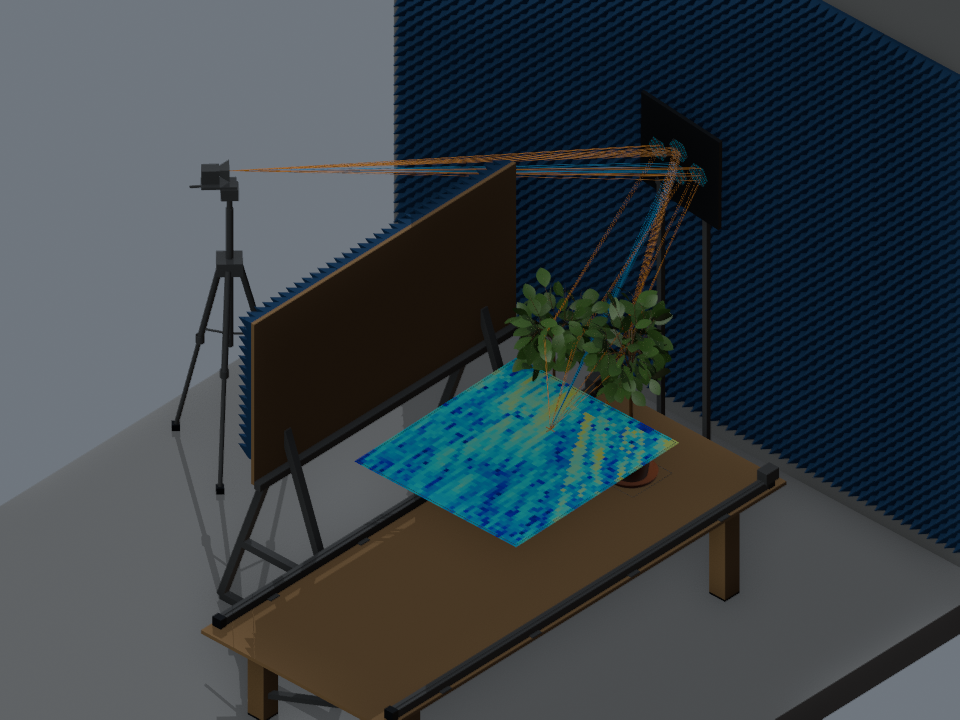

# Parametric environment

Open `scenes/IAT_Lab.blend` in Blender 5.2.3 LTS. In the Outliner, expand
**`00 IAT Controls`**, select a **`CTRL | …`** object, and open its
**`IAT - component controls`** Geometry Nodes modifier. Drag the numeric fields
to change the model. The saved inputs reproduce the original layout.

The working model has **19 assembly controllers and 44 Geometry Nodes groups**:
19 control groups, 19 member-transform groups, four attached-absorber groups,
and the two inherited path-display groups. The protected original remains in
`assets/baseline/`. Exact default values and member names are in
[`config/parametric_defaults.json`](../config/parametric_defaults.json).

## Controls shared by every assembly

| Input | Meaning |
| --- | --- |
| `Position` | Assembly pivot in world coordinates, in metres. Defaults are the center of the assembly's original world-axis bounds. |
| `Rotation` | XYZ Euler rotation about that pivot. Zero preserves the original geometry's orientation; Blender displays angles according to its unit settings. Python values are radians. |
| `Size` | Extent in the original world axes, in metres, before the new rotation. Each axis rescales the assembly relative to its original extent. |
| `Enabled` | Switches the assembly's evaluated geometry on/off, including RF export. This is separate from the presentation cutaway. |

Use the modifier's `Position`, not the controller object's ordinary G/R/S
transforms. The controller is a one-point data carrier: its node values drive
the model. Positive sizes preserve orientation. Thin/planar dimensions use a
1 mm normalization floor to avoid division by zero.

Every member object also has an **`IAT - parametric geometry`** modifier with
`Part offset`, `Part rotation`, `Part scale` and `Part pivot`. These allow local
adjustments, such as moving a scanner rail relative to its table. The part
transform happens before the assembly transform. `Part pivot` is initialized
to the part's baseline center; normally leave it alone. Use the wall's **CTRL**
inputs for coordinated wall/absorber changes; a local change on only the wall
body intentionally does not edit its separate absorber object.

These controls transform the saved detailed meshes. They preserve door openings,
scanner parts, plant topology and the 508-cell layout. They do not procedurally
add leaves, change the number of RIS cells, or automatically resolve collisions.
Cameras and lights keep their ordinary Blender controls. The hidden original
bench remains an archival reference.

## Assembly reference

| Controller suffix | Members and intended use |
| --- | --- |
| `Wall X min`, `Wall X max`, `Wall Y min`, `Wall Y max` | Four independent concrete walls, each with an attached RF-absorber option. Door geometry is a separate assembly. |
| `Floor`, `Ceiling` | Independent room slabs; their Size controls also determine the wall-slab thickness used by the exporter. |
| `RIS aperture` | Backing board, 508 cell centers, active/reflective glyphs and the frame anchor. Move or rotate the aperture together. |
| `RIS stand` | Metal support, independent of the aperture. Adjust it to support a changed aperture position. |
| `Scanner table` | Three static support/table meshes and the assumed support-plane outlines. |
| `Scanner mechanics` | Archived bridge, carriage and RX assembly. They retain their saved hidden presentation state and RF exclusion. |
| `Scanner sampling plane` | All 2,300 receiver points and four boundary outlines. Moving the table does not automatically move this independently controlled plane. |
| `TX assembly` | Tripod, feet, head, horn display and phase-center anchor. |
| `Blocker` | Wooden panel, supports and its existing absorber face. |
| `Door` | Metal frame and wooden door component. Adjust alongside the wall opening if you resize that wall. |
| `Pipes` | Existing pipe meshes. |
| `Light fixtures` | Metal fixture bodies and glass diffusers; separate from the actual Softbox lights. |
| `Plant 1`, `Plant 2` | Each plant's leaves, pot, saucer, stem/reference parts and root anchor. Position/scale controls retain their existing shape. |
| `Target marker` | Target cross, receiver target anchor and the scene-01 custom-target helper. |

The same controllers and common objects are shared across the four scenes. An
environment edit therefore applies to every variant using that object. The
plant objects remain absent from the two no-plant scenes. Changing the active
scene selects the matching archived results and glyph collection; it does not
create an independent environment copy.

## Attached wall absorbers

The X-min, X-max and Y-min walls start with their original absorber meshes On.
Y-max has a mirrored panel available but starts **Off**, preserving the supplied
layout. The optional Y-max panel is rectangular: fit its coverage/offset around
the door as appropriate before using it; enabling it can cover the doorway.

| Wall input | Behavior |
| --- | --- |
| `Absorber enabled` | Keeps or removes that panel's geometry. Turning the entire wall assembly Off also removes its panel. |
| `Absorber depth` | Overall geometric panel/pyramid depth in metres; approximately 0.095 m at the saved defaults. Independent of wall thickness. |
| `Absorber gap` | Gap from the wall's interior face to the panel's back, approximately 0.003 m by default. |
| `Absorber scale` | Additional coverage multiplier. For X walls, Y/Z control coverage; for Y walls, X/Z control coverage. The wall-normal component is ignored: use Depth. |
| `Absorber offset` | Extra offset in the wall's original axes, applied before wall rotation. |

Wall resizing scales panel coverage and its tangential placement. The panel's
normal position is recomputed from half the wall thickness, the mounting gap,
and half the panel depth; wall rotation then carries both together. The original
pyramid meshes are rescaled, not regenerated with a different pyramid count.

Geometric depth and the **RF material's slab thickness** are distinct values.
The archived absorber proxy uses a 0.1 m electromagnetic slab assumption. A
0.095 m visible pyramid does not establish the correct equivalent slab model.
See the [material supplement](RADIO_MATERIALS.md).

## Visibility and RF inclusion

The original cutaway's eye/camera flags are retained. A hidden wall can still
have its controls changed. Reveal it using the [visibility guide](SCENE_GUIDE.md)
when you want to inspect it visually.

- Object eye/camera hiding controls the presentation.
- Controller `Enabled` and `Absorber enabled` control evaluated geometry.
- Object custom property `iat_export` explicitly controls RF export membership.

The exporter includes enabled RF walls even when the Outliner hides them. It
does not export display guides, controllers, glyphs, path tubes, heatmaps or
reference benches as obstacles. It restores the original visibility flags after
evaluation. Enabling a controller does not make a visual-only object RF-active.

Original empty anchors are represented by one-point meshes so they can follow
Geometry Nodes without drivers. They have no renderable faces. Their evaluated
positions, the RIS cell positions and the receiver grid are exported separately.

## How the nodes communicate



The implementation uses ordinary Geometry Nodes and named attributes. It needs
no installed add-on, Python handlers, expressions or enabled auto-run scripts.
The graphs are generated by [`iat_lab/nodes/parametric.py`](../iat_lab/nodes/parametric.py),
with reusable graph-building helpers and one group per assembly role.

## Rebuild and reset

The controls' original values are recorded in both the node interfaces and
`config/parametric_defaults.json`. Blender's input reset operation restores an
individual input's default. To produce a fresh model from the protected source:

```powershell
$blender = 'C:\Program Files\Blender Foundation\Blender 5.2\blender.exe'
& $blender --background --factory-startup --disable-autoexec --python-exit-code 1 --python scripts/build_parametric_scene.py -- --output build/fresh-parametric.blend
```

The builder refuses to overwrite an edited output unless `--replace` is supplied.
It reads the material catalog from `config/radio_materials.json`; an existing
catalog is preserved. It regenerates `config/parametric_defaults.json` from the
baseline. The original two path graphs remain embedded assets, not Python rebuilds.

## Saved results after an edit

Each variant has its own results parent, with two subcollections:

```text
Results parent for the selected scene
├── Paths | <scene name>
│   └── PATHS object
└── Heatmap | <scene name>
    └── HEATMAP object
```

The existing results-parent names are retained. Use the child collection's eye
or camera icon to show/hide paths and maps separately; the parent controls both.
The per-scene memberships are recorded in `config/parametric_defaults.json`.

Path tubes, heatmaps and RIS states are **archived baseline data**. Moving a
wall, plant, RIS or receiver does not update them. Export the edited geometry
and run a new solver before interpreting a changed layout physically. The
[Sionna workflow](SIONNA_EXPORT.md) supplies geometry and material loading;
it does not reproduce the archived custom RIS two-hop calculation.

## Default-layout comparison

Both views use the same camera and Workbench settings. The parametric defaults
preserve the geometry; canonical RF materials can change preview colors. The
colored map and path tubes in these views are the archived results.

| Original baseline | Parametric defaults |
| --- | --- |
|  |  |
