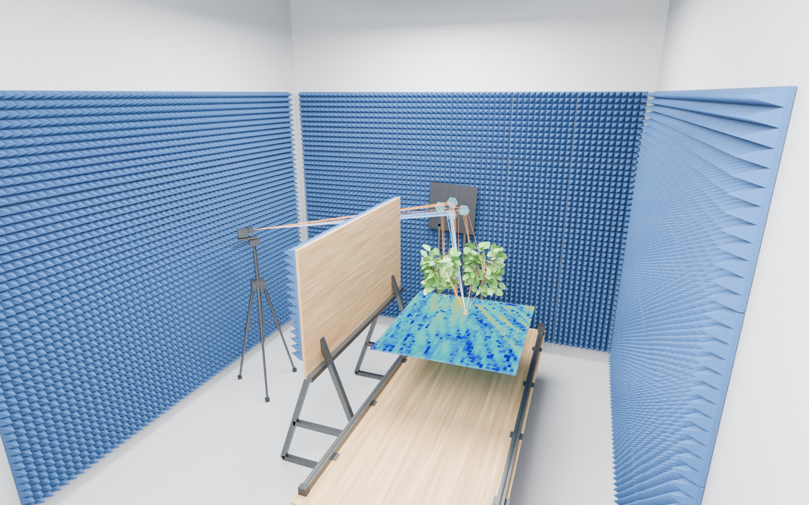
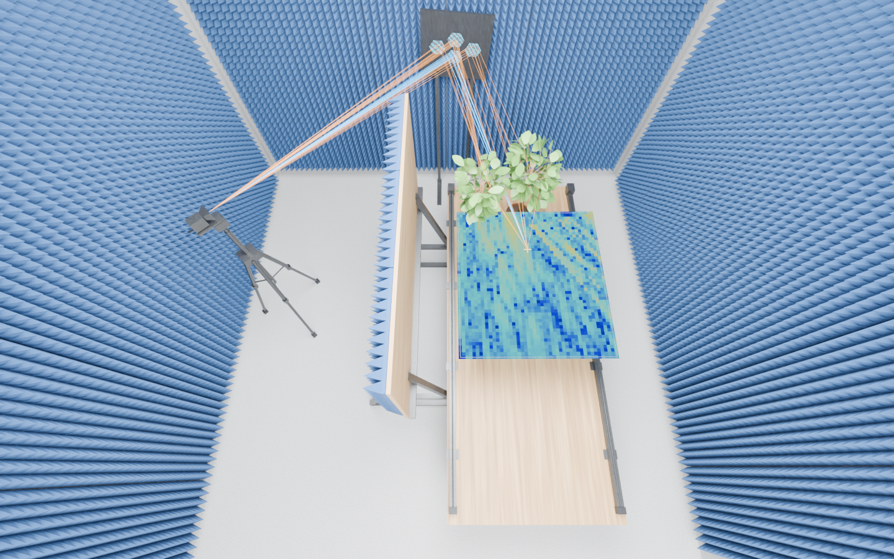
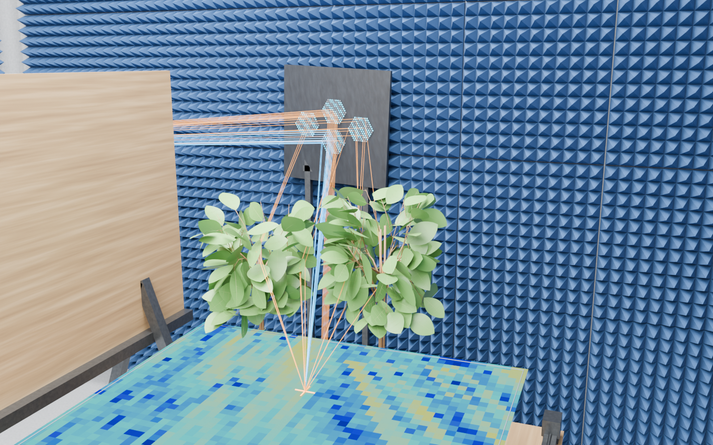

# Cycles previews and reference images

For the compact looping GIF shown in the README, see the [setup animation](ANIMATION.md).

These images are native Blender **Cycles** renders of `scenes/IAT_Lab.blend`,
using the saved default layout with **all four walls, the floor and the ceiling
visible**. Dedicated perspective cameras and softbox lights are placed inside
the room for these previews; the original saved cameras remain available.
The orange paths and colored scanner heatmap are **archived results** embedded
in the source model. They are not new Sionna RT 2.2 simulation outputs.

## Apparatus overview



The overview camera looks into the apparatus from the rear-left of the room,
showing the transmitter, absorber walls, blocker, RIS, scanning table and plants.

## Elevated interior view



The elevated camera sits below the ceiling and looks down toward the apparatus.
This is a perspective view, not a dimensioned plan or a surveyed reference.

## Plant and RIS detail



The close-up camera shows the plants and nearby apparatus. Materials here control
visible appearance; the [radio-material catalog](RADIO_MATERIALS.md) defines
electromagnetic properties separately.

## Reproduce the previews

From the repository root, with Blender 5.2.3 LTS:

```powershell
$blender = 'C:\Program Files\Blender Foundation\Blender 5.2\blender.exe'
foreach ($view in 'overview', 'top', 'detail') {
    & $blender --background --factory-startup --disable-autoexec scenes/IAT_Lab.blend --python-exit-code 1 --python scripts/render_previews.py -- --view $view
    if ($LASTEXITCODE -ne 0) { throw "Render failed: $view" }
}
```

Defaults: Cycles CPU, 1440 × 900 pixels, 64 maximum samples, adaptive threshold
0.035, OpenImageDenoise, seed 42, AgX and exposure 0. Rendering does not save
over the model. The script restores the room's presentation visibility, then
adds temporary interior cameras and lights. Wall/absorber Geometry Nodes switches
still determine whether the corresponding geometry exists.
Run one view per Blender process to isolate Cycles/denoiser state. Camera presets
fit the default room; edit `VIEWS` in the
render script when changing the room layout substantially.
The settings records for [overview](images/cycles/overview_settings.json),
[elevated view](images/cycles/top_settings.json) and [detail](images/cycles/detail_settings.json) include the source
model hash, Blender version, camera positions/lenses, lights and PNG hashes. Different Blender builds
or hardware may produce slightly different pixels despite matching settings.

Use `--view overview` (the default), `--view top` or `--view detail` after Blender's `--`
separator to render one camera. Other options are `--samples`, `--width`,
`--height`, `--output` and `--hide-results`. For example:

```powershell
& $blender --background --factory-startup --disable-autoexec scenes/IAT_Lab.blend --python-exit-code 1 --python scripts/render_previews.py -- --hide-results --samples 128 --output renders/clean-preview
```

For interactive visibility, each scene has its own results parent with
separate `Paths | <scene>` and `Heatmap | <scene>` children. Toggle either child
in the Outliner, or the parent to toggle both. See the
[scene guide](SCENE_GUIDE.md) and [parametric guide](PARAMETRIC_ENVIRONMENT.md).

## Procedural surface finishes

The working model includes self-contained shader textures for wood, plywood,
chipboard, concrete, blue RF absorber and metal. No external texture images or
UV unwrap are required. These are illustrative finishes, not an identification
of the real lab's paint, timber species or absorber product.

In Blender's Shader Editor, select the corresponding material. The labeled
`Grain direction / texture scale` vector controls grain proportions;
`Wood fibers` or `Fine surface variation` controls texture detail;
`Surface color range` controls color. The Principled BSDF Roughness and Metallic
inputs control the optical finish. The Bump node adds submillimetre shading
relief without moving vertices or changing RF geometry.

Wood uses elongated procedural noise, concrete uses subtle mottling and a fine
normal perturbation, absorber foam uses a matte porous finish, and metal has
slight surface variation. The builder recreates these shaders from
[`iat_lab/blender/appearance.py`](../iat_lab/blender/appearance.py).
The [radio properties](RADIO_MATERIALS.md) and Sionna export remain independent
of these colors, optical roughness values and bump nodes.
Wood grain variants with `_grain_x` or `_grain_y` suffixes align the fibers with
the part's longest saved axis; they retain the same canonical radio-material key.

## Original lab references

The repository now includes [two lab photographs, a dimensioned room plan and
a model-derived schematic](../assets/references/README.md), copied unchanged
from the subsequently supplied `01_RIS` folder. They are stored separately from
the generated renders and explanatory node diagrams. Generated previews and
model schematics should not be treated as measured references.

An audit of the supplied `RIS_Repository_Structure_Update_2026-11-08` archive
found simulation figures and workflow-animation media. Its workflow notes say
a reference photograph is included inside the animation, not distributed as
a separate asset. Those surrounding media have not been imported here; see
[model provenance](PROVENANCE.md).

The subsequently supplied `01_RIS` folder does contain laboratory photographs,
a dimensioned room drawing and model-derived schematics. See the
[lab reference audit](LAB_REFERENCES.md) for exact filenames, useful evidence
and the distinction between photographs, model drawings and conceptual artwork.
