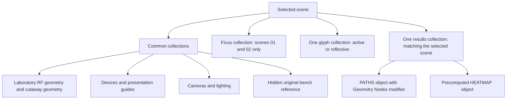

# Scene organization and visibility

This guide describes the saved `scenes/IAT_Lab.blend`, inspected directly in
Blender 5.2.3 LTS on 10 November 2026. It covers all **four scenes, 12 collections,
86 object datablocks and two Geometry Nodes groups**. Counts include cameras,
lights and helper objects. The model was inspected without saving it.

For the path graphs and every exposed control, continue to
[Geometry Nodes and controls](GEOMETRY_NODES.md). The compact
[inspection record](scene_reference.json) records scene membership, hidden
objects and actual saved modifier values. The original
[viewing notes](../data/embedded/START%20HERE.txt) provide the historical modelling
context.

## 1. Choose a scene

Use Blender's scene selector to switch the complete presentation. Each variant
links shared laboratory objects together with the appropriate plants, cell
glyphs, path modifier settings and heatmap.

| Scene | Objects | Plants linked? | Glyph profile | Results collection | Reflective RIS mode | Without plants |
| --- | ---: | --- | --- | --- | --- | --- |
| `01 Plants - active RIS` | 79 | Yes | Active | `05 Embedded simulation results` | Off | Off |
| `02 Plants - reflective RIS` | 78 | Yes | Reflective | `02 Plants - reflective RIS \| results` | On | Off |
| `03 No plants - active RIS` | 56 | No | Active | `03 No plants - active RIS \| results` | Off | On |
| `04 No plants - reflective RIS` | 56 | No | Reflective | `04 No plants - reflective RIS \| results` | On | On |

Every scene has one view layer, named `ViewLayer`, and starts at frame 1 with
`CAM 1 | apparatus and paths` as its camera. Units are metric, with scale length 1.0.
The no-plant variants are computational baselines, not additional measurements.

The diagram groups the collections by purpose. These are conceptual groups;
the actual linked collections are siblings directly below **Scene Collection**.

`RIS_Custom_Target` is an additional empty linked directly to scene 01's root,
outside the 12 collections. It records a custom-world-coordinate target helper
and is marked Blender-only. It accounts for scene 01's extra object relative
to scene 02.

## 2. Collection reference

Counts below are direct object memberships. No collection has child collections.
An object linked into several scenes is still one shared object datablock.

| Exact collection name | Objects | Linked scenes | Purpose and contents |
| --- | ---: | --- | --- |
| `01 RF - full laboratory` | 18 | All | Floor; X-min and Y-min walls; absorber proxies; wooden blocker and supports; two door assemblies; three static scanner/support meshes; RIS mount/stand; TX tripod/head. These provide the main laboratory context and archived RF geometry. Two X-min objects are hidden for the cutaway; see below. |
| `02 RF - walls hidden ONLY for cutaway` | 7 | All | Ceiling, X-max and Y-max walls, X-max absorber, pipes and two light-fixture meshes. All seven objects are hidden in the saved viewport and render. They were present in the archived RF calculation. |
| `03 RF - close-pair Ficus` | 22 | 01, 02 | Eleven parts for each plant: `Branches`, `Leaves`, `Petioles`, `Pot`, `Root`, `Saucer`, `Soil`, `Stake`, `Ties`, `Trunk`, `Veins`. Leaves and pots participate in the archived vegetation model; a collection's RF prefix does not make every member RF-active. |
| `04 Devices and presentation guides` | 18 | All | Display horn; three archived moving-scanner parts; TX phase-centre and RX-target markers; RIS frame and cell-centre/profile mesh; RX sample grid; four scanner-area boundary objects; three target-cross objects; two assumed support-plane outlines. The three moving-scanner objects are hidden. |
| `05 Embedded simulation results` | 2 | 01 | `PATHS \| select receiver, tile and reflection type` and `HEATMAP \| active \| -90 to -20 dBm`. Active-RIS, plants-present presentation. |
| `02 Plants - reflective RIS \| results` | 2 | 02 | `PATHS \| 02 Plants - reflective RIS` and `HEATMAP \| reflective \| -90 to -20 dBm`. |
| `03 No plants - active RIS \| results` | 2 | 03 | `PATHS \| 03 No plants - active RIS` and `HEATMAP \| no_plant_active \| -90 to -20 dBm`. |
| `04 No plants - reflective RIS \| results` | 2 | 04 | `PATHS \| 04 No plants - reflective RIS` and `HEATMAP \| no_plant_reflective \| -90 to -20 dBm`. |
| `06 Cameras and lighting` | 7 | All | Four cameras and `Softbox`, `Softbox.001`, `Softbox.002`. The light-fixture meshes in the cutaway collection are separate from these actual Blender lights. |
| `REFERENCE ONLY \| original 0.75 m bench - hidden` | 3 | All | `Original bench 18`, `Original bench 19`, `Original bench 20`: preserved taller-bench geometry, hidden and explicitly excluded from the saved simulation. |
| `RIS glyphs - active profile` | 1 | 01, 03 | `RIS cell glyphs \| active ON blue, OFF dark`: visualizes the frozen active profile. |
| `RIS glyphs - reflective profile` | 1 | 02, 04 | `RIS glyphs \| reflective phase states`: visualizes the frozen reflective profile. |

### Plant geometry and the support bench

`Plant1_Leaves` and `Plant2_Leaves` contain 128 and 148 explicit leaves. The plants
are saved meshes; neither Geometry Nodes group generates them. Stems, branches,
petioles, veins, soil, stakes and ties are visible references excluded from this
archived RF calculation. Check an object's `RF_included_in_saved_simulation`,
`sionna_blender_only`, `sionna_ris_reference_only` and `scope` properties where
present; collection labels and visual materials alone do not define RF inclusion.

The lower support plane is an **unconfirmed 0.50 m geometry hypothesis**. The
original 0.75 m bench is retained for comparison because it intersects the lowered
plant layout. The guide preserves this distinction; it does not establish either
height as a new measurement.

### Glyphs and numerical results

The cell-centre/profile mesh and glyphs are presentation aids for 508 cells in
four 127-cell tiles. The saved active profile has 269 ON and 239 OFF cells. The
reflective profile uses magnitude 0.3 and phases of -15 and 165 degrees. These are
frozen model profiles, not recovered experimental state measurements.

The four heatmaps are separate saved meshes. They show raw simulated power on
the saved tilted scanner plane, using a fixed -90 to -20 dBm scale. A path filter
does not recolor or recompute them. The embedded maps use coherent sums of all
calculated paths; the interactive path display contains a selected subset for
grid receivers. See [display versus computation](GEOMETRY_NODES.md#7-display-versus-computation).

## 3. Visibility rules

### The saved state

All 12 collection datablocks have `hide_viewport = false` and
`hide_render = false`. Every linked layer collection has `exclude = false` and
`hide_viewport = false`. All object-level monitor flags (`hide_viewport`) are
also false.

The cutaway is implemented at the **object** level: 15 objects have the eye
state hidden (`hide_get(view_layer=...) = true`) in every scene's view layer,
and the same 15 have `hide_render = true`.

| Collection | Objects hidden in both saved viewport and render |
| --- | --- |
| `01 RF - full laboratory` | `Wall_X_Min \| RF 03`; `Absorber_Wall_X_Min \| RF 08` |
| `02 RF - walls hidden ONLY for cutaway` | `Lab_Ceiling \| RF 02`; `Wall_X_Max \| RF 04`; `Wall_Y_Max \| RF 06`; `Absorber_Wall_X_Max \| RF 09`; `Pipes_All \| RF 15`; `Light_Fixtures \| RF 16`; `Light_Fixtures \| RF 17` |
| `04 Devices and presentation guides` | `Scanner_X_Bridge`; `Scanner_Y_Carriage`; `Scanner_RX_Assembly` |
| `REFERENCE ONLY \| original 0.75 m bench - hidden` | `Original bench 18`; `Original bench 19`; `Original bench 20` |

**Showing the cutaway collection alone will not reveal its objects.** Its
collection flags are already enabled. Likewise, two hidden walls are outside
the collection whose name mentions the cutaway.

### What the controls affect

| Mechanism | Scope | Consequence here |
| --- | --- | --- |
| Collection linked to a scene | Scene composition | The Ficus collection is absent from scenes 03/04; it is not merely hidden there. Only the matching result and glyph collections are linked to each scene. |
| View-layer collection exclusion | A view layer | Excludes that collection from that view layer's evaluation. None is excluded in the baseline. |
| Eye / `hide_set` | Object in a view layer | Temporarily hides an object in that view layer's viewport. It does not itself hide the object in the render. |
| Monitor / `hide_viewport` | Object or collection datablock | Disables viewport display and can affect all scenes sharing that datablock. |
| Camera / `hide_render` | Object or collection datablock | Controls render visibility; changing it affects linked uses of that object or collection. |
| Geometry Nodes modifier display buttons | One modifier | Controls whether the evaluated path tubes appear in the viewport/render. All four path modifiers are enabled for both. |
| Path modifier inputs | One path object | Filter or style the saved path data; do not update the heatmap, glyph collection or scene membership. |

The collection and object controls can combine: an enabled object can still be
invisible because its collection is excluded or disabled. Viewport local view
can also isolate objects during interactive editing; it is separate from the
saved scene rules described above.

### Reveal a full-room view

1. Choose the desired scene and make `CAM 4 | entire room` active.
2. In the Outliner, expose the eye and camera restriction columns if necessary.
3. Clear the eye hiding on the **seven cutaway objects** and on
   `Wall_X_Min | RF 03` and `Absorber_Wall_X_Min | RF 08`.
4. For a full-room render, enable the camera icons for those same nine objects.
5. Leave the three moving-scanner references and the three original-bench
   objects hidden unless you deliberately want a reference comparison.

For a script running inside Blender, the equivalent object operations are
`obj.hide_set(False, view_layer=layer)` and `obj.hide_render = False`. The eye
change is view-layer-specific; the render flag belongs to the shared object.
Save a separate presentation version if you want to retain the original cutaway.
These changes do not recalculate the archived radio results.

## 4. Cameras and shared data

| Camera | Intended view |
| --- | --- |
| `CAM 1 \| apparatus and paths` | Default apparatus and propagation-path presentation |
| `CAM 2 \| top - exact scale` | Top view for layout inspection |
| `CAM 3 \| plant gap` | Close view of the inter-canopy gap |
| `CAM 4 \| entire room` | Room overview; reveal hidden room objects when needed |

Common collections and their objects are linked across scenes. Moving a shared
wall, changing its material or editing a shared camera affects its other scene
uses. Switching scenes does not create independent copies of those objects.

All four `PATHS` objects share one source mesh datablock, named
`PATHS | select receiver, tile and reflection type`, and the same outer node group.
Their modifier input values are stored separately. Editing the shared mesh or
node-group topology affects all four; changing one object's receiver control
affects that object's modifier. Make the relevant data single-user before
creating an intentionally independent experiment.

## 5. Common tasks and troubleshooting

| Task or symptom | What to do |
| --- | --- |
| Compare active and reflective cases | Switch scenes 01/02 or 03/04. This selects the matching path mode, glyphs and heatmap together. |
| Compare plants versus no plants | Switch between 01/03 or 02/04. Do not only toggle `Without plants` and leave a conflicting presentation around it. |
| Room still looks cut away | Check the nine room objects' eye and camera flags, including the two in the main RF collection. |
| No plants appear in scene 03/04 | Expected: the plant collection is not linked into those scenes. |
| A selected cell has no paths | Set `Paths per class` to 0, relax the gain/delay filters, and inspect the interaction switches. Some cases have no nonzero saved contribution. |
| Bypass disappears after selecting a tile/cell | Bypass records have tile/cell index -1. A specific nonnegative tile/cell selection removes them; use -1 for both to show bypass. |
| Path appearance changes but heatmap does not | Expected: controls operate on the saved path display only. |
| Moving a plant leaves paths passing through its old position | Saved path coordinates and heatmaps are static. A new physical result requires a separately validated simulation workflow. |
| Need the original viewing text | Open `START HERE.txt` in Blender's Text Editor or use its exported copy linked above. |

## 6. Evidence and scope

The inspected file has SHA-256
`a35ca6ee3aa93de6d6f04ae69da4aa31e47777c757e6b2c14e596f15f0436588`.
The [reference record](scene_reference.json) is documentation evidence for this
saved version. After model edits, re-inspect visibility and modifier inputs
before treating this guide's baseline values as current.

The initial [baseline inventory](../data/baseline_inventory.json) records
collection membership, object transforms and graph structure. It does not
record view-layer eye states; its modifier custom-property fields also omit
Blender 5.2's RNA-based input values. Those values were read directly for this
guide, as explained in the [node guide](GEOMETRY_NODES.md#8-inspecting-the-saved-controls).
